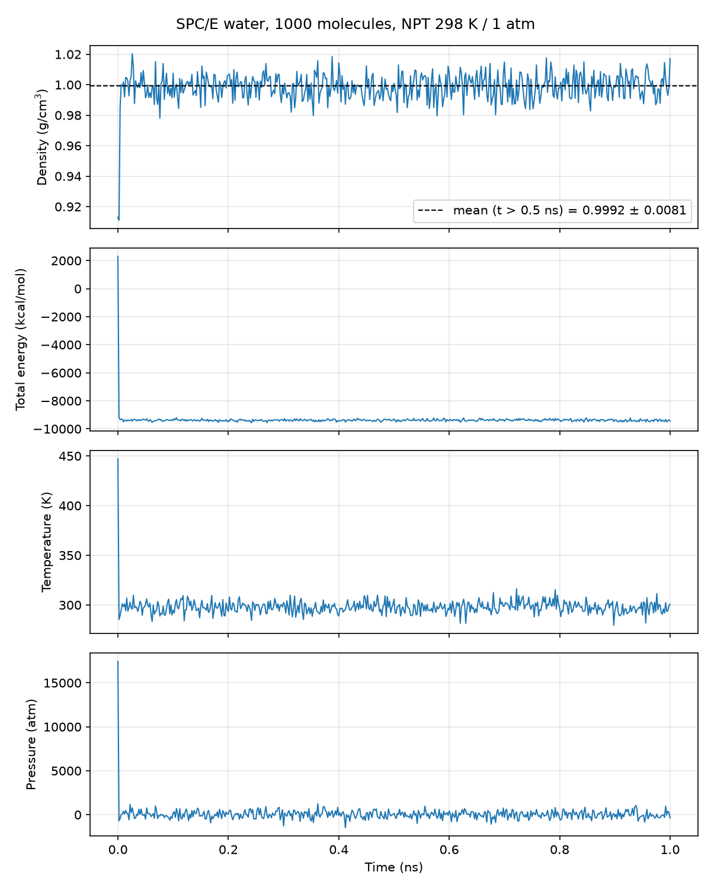

# Water density test (SPC/E, NPT)

1000 SPC/E water molecules simulated for 1 ns at 298 K and 1 atm, tracking how
the density evolves with time.

| Setting        | Value |
|----------------|-------|
| Water model    | SPC/E, rigid (SHAKE on bonds and angle) |
| Nonbonded      | LJ + Coulomb, 10 Å cutoff, PPPM (1e-5), LJ tail correction |
| Ensemble       | NPT, Nosé–Hoover, T = 298 K (Tdamp 200 fs), P = 1 atm isotropic (Pdamp 2000 fs) |
| Timestep       | 2 fs, 500,000 steps = 1 ns |
| Initial state  | 10×10×10 cubic lattice, 3.2 Å spacing, random orientations (ρ₀ ≈ 0.91 g/cm³) |
| Thermo output  | every 1000 steps (2 ps): step, time, total energy, temperature, pressure, density, volume |

## Files

- `in.water` – LAMMPS input
- `water.mol` – SPC/E molecule template
- `analyze_density.py` – parses the log, writes `thermo.csv` and `density_vs_time.png`
- `log.lammps`, `thermo.csv`, `density_vs_time.png` – results of the run

## Results



| Window       | Density (g/cm³)   |
|--------------|-------------------|
| 0–10 ps      | 0.913 → ~1.00 (barostat compresses the lattice start) |
| 0.1–0.5 ns   | 0.9985 ± 0.0069   |
| 0.5–1.0 ns   | 0.9992 ± 0.0081   |

Over 0.5–1.0 ns: T = 297.7 ± 5.6 K, P = 12 ± 396 atm, E_tot = −9381 ± 64 kcal/mol
(± is the standard deviation of the 2 ps samples; instantaneous pressure fluctuations are
large for 3000 atoms). The density agrees with published SPC/E values (≈ 0.998–1.00 g/cm³ at
298 K) and with experiment (0.997 g/cm³). Run time: 63 min on 4 MPI ranks (LAMMPS 22 Jul 2025).
`water_final.data` holds the final configuration for restarts.

## Running

```bash
mpirun -np 4 lmp -in in.water              # full 1 ns run
mpirun -np 4 lmp -in in.water -var nsteps 5000   # quick 10 ps check
python3 analyze_density.py log.lammps
```

Needs LAMMPS with the MOLECULE and KSPACE packages (the PyPI `lammps` wheel works:
`pip install lammps mpich`).
